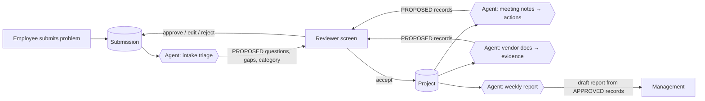

# How the Innovation Hub connects to the Innovation Coordinator

## The one-sentence version
The **Hub** is where people work: they submit problems, review them, and approve or reject. The **Coordinator** is the agent behind it: it reads, analyses and drafts. Every agent output enters the Hub as a **PROPOSED** record, and a person approves it before it counts.

## Who does what

| | Innovation Hub (the app) | Innovation Coordinator (the agent) |
|---|---|---|
| Role | Front door, system of record, approval screen | Analyst and drafter |
| Owns | The database, statuses, permissions, history | Prompts, templates, evals (`coordinator/`) |
| Writes | `APPROVED` records, only after a person acts | `PROPOSED` records only |
| Decides | Nothing. People decide using it | Nothing. It recommends |
| Built with | Plain code: validation, rules, transitions | A language model, called only for reading and drafting |

**Rule of thumb:** anything that must *always* be correct goes in code, never in the model. That covers required fields, allowed status changes, who can approve, and dates. The model handles what needs judgement, such as extracting actions, spotting gaps and drafting questions.

## The flow



1. **Submission.** An employee describes a problem. This is the Hub's intake form.
2. **Intake triage (agent).** The agent checks what's missing from the submission, using the system prompt's "identify gaps" step. It drafts the clarification questions and suggests a category and possible similar past projects. Today the **Next review question** in the sample data is written by hand. This step drafts it instead.
3. **Review (person).** The reviewer approves, edits or rejects the draft questions. The employee answers them.
4. **Accept → Project.** A reviewer turns a promising submission into a Project. That creates the records in `coordinator/memory/schema.md`.
5. **Project workflows (agent).** Meeting notes → actions, vendor documents → evidence comparison, and project records → weekly report. These are the three first-version workflows from the agent design. Each one returns `PROPOSED` records into the same review screen.

## What changes in the Hub's data

The Hub's database **is** the agent's project memory. It uses one schema, not two. Two record types join the existing schema:

**Submission:** `id, title, description, current_process, people_affected, frequency, impact, desired_outcome, suggested_solution, department, submitted_by, created_at, status`
Status: `Submitted → Needs clarification → Under review → Accepted | Declined`

**AgentRun:** one row per agent call, so every output can be traced and tested.
`id, workflow, input_ids, prompt_version, model, started_at, finished_at, output_json, status (Succeeded / Failed), reviewed_by, review_outcome (Approved / Edited / Rejected)`

The `review_outcome` field matters a lot. Over time it shows how often reviewers accept the agent's drafts without changes, which is the clearest measure of whether the agent is useful.

## How the Hub calls the agent

The backend exposes **one endpoint** for all workflows:

```
POST /api/agent/runs   { "workflow": "intake_triage", "input_ids": ["SUB-014"] }
→ creates AgentRun, calls the model with coordinator/agent/system-prompt.md
→ validates the JSON it returns against a schema
→ saves results as PROPOSED records linked to the run
```

- **Structured output.** The model must return JSON that matches a fixed schema, such as `{ "gaps": [...], "questions": [...], "category": "..." }`. If the JSON is invalid, the run fails and nothing is saved.
- **No auto-send, no auto-approve.** The endpoint can only create `PROPOSED` records. Approval is a separate endpoint that requires a person.
- **Documents are data.** Uploaded vendor files are passed to the model as content to analyse, never as instructions. The `meeting-01` eval includes a test for exactly this.

## Framework choice

These workflows are short and mostly linear: read input → call model → validate → save draft → wait for a person. The "wait for a person" step is simply a record with status `PROPOSED` in the database, so it needs no special framework. **Recommendation:** start with direct model API calls from FastAPI. Bring in LangGraph only if a workflow becomes truly branching or long-running. Fewer layers make it easier to learn and to debug.

## How we'll know it works

Each workflow gets eval cases in `coordinator/evals/` *before* it gets a real model. Run the evals on every prompt change and keep the run log in `coordinator/evals/scoring.md`. A workflow only appears in the UI once it meets its targets, including **zero invented owners, dates or numbers**.
