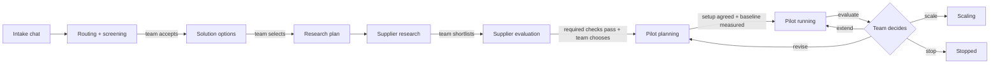

# The innovation lifecycle in the Hub

From an employee's problem to a decision to scale, with a person deciding at every gate. The AI prepares,
drafts and compares; plain-code rules check its work; nothing is sent, bought or approved by the AI.

| Stage | Status | AI does | People do | Gate (enforced in code) |
|---|---|---|---|---|
| Intake | Submitted / Routed | Asks 2–4 questions, fills the summary, checks existing solutions | Describe, edit, submit, request a review | Incidents go to the incident channel first |
| Screening | Submitted | Routes, scores the priority rubric, recommends | Accept / ask / decline / link, correct the screening | Only clear-cut policy declines are automatic |
| Solution options | Accepted | Proposes 3–5 approaches with scores, pros and cons | Compare, ask again, **select one with a reason** | The ranking is calculated in code |
| Supplier research | Research | Searches the web; findings with sources | **Answer the setup questions**, shortlist | A source counts only if it was retrieved; must-haves are pass/fail |
| **Supplier meetings** | Research → Pilot running | Finds official contacts; agenda and invitation drafts; debriefs notes or a Teams recap into actions and next steps | Send from Outlook, confirm times, attend, paste notes | Nothing is sent by the app; owners and dates only from the notes; Today panel reminders |
| **Supplier evaluation** | Research | Meeting brief, questions, **draft** email; extracts answers, risks and actions from meeting notes | Send emails, hold meetings, **run due diligence** | **Pilot partner only when every required check passed** |
| Pilot planning | Pilot planning | Drafts the pilot plan: baseline, success criteria, exit criteria, roles | Agree targets and owners | Targets not in the facts stay "to be agreed" |
| Pilot run | Pilot planning → Pilot running | — | Agree numeric targets and a named owner, measure the baseline, log data and observations | **Start only with a complete setup and a baseline for every metric** |
| Pilot evaluation | Pilot running → Scaling / Pilot running / Pilot planning / Stopped | Writes the narrative only | **Decide: scale, extend, revise or stop**, with a reason | **Verdict calculated in code**: too little data = inconclusive; change within normal variation = no clear change |

## Supplier evaluation in detail
1. **Prepare.**
   - The meeting goal.
   - Up to 8 questions in priority order, with what blocks a pilot first: unconfirmed must-haves, unknown factors, security, data residency, price.
   - Things to ask for in a demo.
   - An outreach email marked **DRAFT, not sent**. A draft that reads like a commitment ("we will purchase…") is flagged.
2. **Contact.** A person records the outreach status: contacted, meeting booked, meeting held, or supplier declined.
3. **Meeting notes.** Paste the notes and the AI extracts:
   - answers to the prepared questions
   - updated findings, labelled **"supplier (meeting, verbal)"** with the meeting date as the source (the comparison is re-ranked)
   - risks
   - actions

   Owners and deadlines that aren't written in the notes become **UNASSIGNED** and **NO DATE AGREED**. Figures that aren't in the notes are dropped.
4. **Due diligence.** Each item has a status, an owner and an evidence note. Marking a required item "not applicable" needs a reason.

   | Check | Required |
   |---|---|
   | Demo or trial on our own data | Yes |
   | Security evidence (e.g. ISO 27001 certificate, SOC 2 report) | Yes |
   | Data residency confirmed **in writing** | Yes |
   | IT confirms it works with current tools | Yes |
   | Pricing and contract terms received in writing | Yes |
   | References contacted | No |
5. **Choose the pilot partner.** Only possible once every required check has passed and none has failed, and the choice needs a reason. The request moves to **Pilot planning**, with a drafted pilot plan.

## Pilot evaluation rules (`backend/research/pilot.py`)
For each success criterion, the code compares the baseline average with the pilot average:

| Situation | Result for that criterion |
|---|---|
| Fewer than the agreed minimum of baseline or pilot measurements | **not enough data** |
| Change no bigger than the baseline's normal variation (standard deviation) | **no clear change** |
| Pilot average meets the target (≤ target if lower is better, ≥ if higher is better) | **target met** |
| Better than the baseline but short of the target | **improved, target not met** |
| Worse than the baseline | **worse** |

| Overall | Verdict | Recommendation |
|---|---|---|
| Any criterion has not enough data | inconclusive | **extend** (collect the data first) |
| Every criterion met its target | success | **scale** |
| Some met, or some improved | partial | **revise** and pilot again |
| Nothing improved beyond normal variation | no improvement | **stop** |

The team always makes the final decision, with a reason, and the app records whether it agreed with the recommendation.
