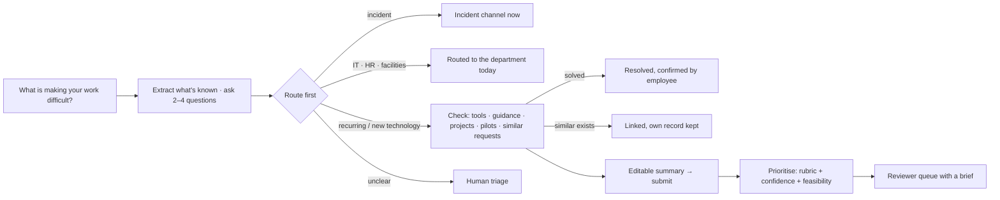

# Intake and routing design

**One employee-facing entry point, two linked processes:** getting help today, and identifying improvements worth exploring. Routine requests reach the department that can resolve them. The innovation team receives clear opportunities, with supporting evidence.

The design borrows patterns from published enterprise workflows: conversational demand intake, virtual service agents that route to human teams, and innovation backlogs scored on value and risk. It's a workflow pattern comparison, not a tested product ranking. Every example below is illustrative, not a claim about Khazna's operations.

## The journey

"Submit now" and "Request innovation review" are available at every step after the first message.

## 1. Make submission very easy
- The chat opens with **"What is making your work difficult?"**. No category, solution or cost is needed.
- The assistant extracts what it already knows (frequency, people or locations, quantified impact). Then it asks **one question at a time, at most 4**, and stops when it has enough. The questions are:
  - What happens today, and what should happen instead?
  - How often does it happen?
  - Who, or which locations, does it affect?
  - What time, cost, delay or risk does it create?
  - What have you already tried?
- "I don't know" is always accepted. Missing details never block submission.
- The summary is visible and editable throughout.
- Code: `backend/intake/brain.py` (questions, extraction) and `backend/intake/workflow.py` (`ask_next`, `MAX_QUESTIONS`).

## 2. Route requests before ranking them
**Urgency and innovation potential are separate decisions.** Every request gets a `route` (who acts first) and, separately, an `innovation_track` (`none`, `screening` or `employee_requested`).

| Request | Route | Innovation involvement |
|---|---|---|
| Active cooling failure, electrical hazard, security incident | Incident channel, immediately | Can come back afterwards to log an improvement |
| Password, access, laptop | IT support | Usually none |
| Leave, payroll, policy | HR | Usually none |
| Repair, replacement, purchase | Facilities, maintenance or procurement | Only if a wider problem emerges ("There's a wider problem" button, or recurring/wider-impact signals) |
| Recurring manual work, repeated errors, fragmented data | Process owner + innovation screening | Screening |
| New technology, different way of working | Innovation screening | Screening. The assistant first asks which problem it solves |
| Unclear | Human triage | A person decides. The assistant doesn't force a category |

These routes are **proposals to validate with the real department owners**. Code: `rules.classify_route` and `workflow.decide_track`.

## 3. Check existing solutions and related requests
The assistant checks, in order:
1. Approved guidance and existing tools
2. Active projects and previous pilots
3. Similar employee submissions

- **Existing tool:** the employee can answer "Solved", "Helps today, but still worth improving" (the opportunity stays open) or "No".
- **Active project or similar request:** "A similar improvement is already being reviewed. Would you like to add your experience?" The employee's **own record is saved and linked**, and the opportunity's supporter count goes up. Only the ID, title and status of someone else's request are shown.
- **Previous pilot:** its result is added to the brief as a previous attempt.

## 4. Push opportunities to innovation
A request goes to innovation screening when it describes a meaningful unmet need **and** shows at least one signal:
- recurring effort
- wider impact
- measurable improvement
- need for experimentation
- persistent failure

Code: `rules.SIGNALS`.

## 5. Prioritise transparently
PROPOSED rubric (`backend/review/screening.py`):

| Criterion | Weight |
|---|---:|
| Potential business impact | 35% |
| Frequency and reach | 25% |
| Alignment with agreed business priorities | 20% |
| Need for innovation or experimentation | 20% |

- Each criterion is scored **0–5 with a reason**. **Unknown is not zero:** unknown criteria are left out and the weights re-balanced.
- **Confidence** shows how much of the rubric was known: high (≥ 80%), medium (≥ 55%) or low.
- **Feasibility** is a separate label (ready to investigate / needs discovery / blocked), so easy projects don't crowd out valuable but less understood ones.
- Reviewers can correct any score, the route, or the feasibility. Corrections are logged and kept when the request is re-screened.
- **Employee-requested reviews** have their own visible queue and always get a human decision, even when the assistant recommends another route. Automatic policy declines never apply to them. The override guarantees consideration, not funding.

## 6. A brief reviewers can act on
Each handover contains:
- the problem and desired outcome
- affected users, process and locations
- frequency and reported impact
- existing solutions checked, and previous attempts
- related submissions or projects
- **facts, estimates and missing evidence, kept separate**
- the routing recommendation and priority rationale
- the proposed next step and suggested business owner

**Vendor research comes after initial screening.** The next step says so explicitly.

## 7. The demo and how success is measured
The demo has three labelled example cases, one click each in the chat:
1. **Routine support:** "I cannot access the reporting system." → IT support
2. **Recurring reporting problem:** "Every week, we manually combine reports from several systems." → process owner + innovation screening, with a brief
3. **Linked to an existing opportunity:** inspection paperwork → linked to SUB-0001

Measures (`GET /api/metrics`, shown in the reviewer view):

| Measure | How it's counted |
|---|---|
| Submission time | Median seconds from opening the chat to submitting |
| Routing accuracy | Share of reviewed requests whose route wasn't corrected |
| Reviewer time per request | Median seconds from opening a request to deciding |
| Missed opportunities | Requests first routed away (IT, HR, facilities, triage) that were later accepted for innovation |
| Employee satisfaction | 1–5 ease rating at the end of the chat |
| Confirmed resolutions | Employee-confirmed self-service, plus routed requests the employee marked resolved |

**Fewer escalations alone are not counted as success.**

## Automation boundaries
- **Automatic:**
  - asking questions, routing, checking and linking (with the employee's confirmation)
  - prioritising, recommending, and drafting messages
  - declining requests that aren't requests, or that would weaken a safety or security control (not for employee-requested reviews; the employee can appeal once)
- **Always a person:**
  - accepting into discovery
  - declining for any other reason
  - every employee-requested review
  - spending, vendor contact and projects
